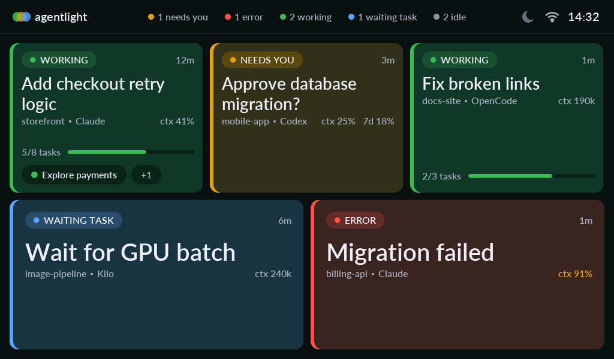

# Agentlight

A touchscreen for your desk that shows what your coding agents are doing, and tells you when one needs you.



Agentlight works with **Claude Code, Codex, OpenCode and Kilo**. A small helper program runs on your Linux computer and sends session status to the display over USB or encrypted Wi-Fi.

It's based on the ideas and serial protocol of [managents](https://github.com/tonylook/managents).

## What you need

- A **Waveshare ESP32-S3-Touch-LCD-5B**, the 1024 × 600 touch model (not the 800 × 480 version)
- A Linux computer with [Rust](https://rustup.rs/), Python and [PlatformIO Core](https://docs.platformio.org/en/latest/core/installation/index.html)
- A USB data cable

3D-printable cases are in [`enclosure/`](enclosure/README.md). **They're a work in progress**, so expect fit problems and changes.

## Quick start

**1. Flash the display.** Connect it over USB, then run this from the repository root:

```sh
cd firmware
pio run -t upload
cd ..
```

The first build downloads the ESP32 toolchain, so it takes a while.

**2. Start the helper:**

```sh
cargo run --release
```

The display finds the helper by itself and your sessions appear within a few seconds. To try it without touching real sessions, run `cargo run --release -- --demo`.

## Using the display

Each session is a card, colored by status:

| Status | Color | Meaning |
|---|---|---|
| **WORKING** | Green | The agent is busy |
| **NEEDS YOU** | Amber | It's waiting for your input or permission |
| **WAITING TASK** | Blue | It's blocked on a command, task or worker it started |
| **ERROR** | Red | Its last turn failed |
| **IDLE** | Gray | Nothing has happened for 2 hours |

The top bar shows a count for each status, the time, and whether the display is on USB or Wi-Fi.

| To do this | Do this |
|---|---|
| Read a session's live conversation | Tap its card |
| Read a subagent's conversation | Tap its pill on the card |
| Scroll back through a log | Drag; tap **Jump to latest** to follow again |
| Show or hide idle sessions | Tap the idle count in the top bar, such as `6 idle` |
| Change page, with more than nine sessions | Swipe, or tap the page dots |
| Turn on sleep mode | Tap the moon in the top bar |

Idle sessions are hidden by default, and hidden again after a restart.

### Usage figures

Each card shows usage as small text next to the project name. The figures turn amber at 80% and red at 95%.

| Agent | Context | Plan limits |
|---|---|---|
| Claude Code | `ctx 52%` | Not shown |
| Codex | `ctx 27%` | `5h 42%`, `7d 1%` |
| OpenCode | `ctx 490k` (tokens) | Not shown |
| Kilo | `ctx 490k` (tokens) | Not shown |

- `ctx` is how full the session's context was at its last response. When no context size is available, you see tokens instead of a percent.
- Codex plan limits apply to your whole account, so every Codex card shows the same numbers.
- Claude Code only gives its plan limits to a status line script, and Agentlight doesn't install one.

### Sleep mode

Sleep mode turns the screen off when nothing needs you, which is useful on a powerbank. In one test it cut power from 2.2 W to 0.7 W.

Tap the moon to turn it on. The screen turns off after 5 minutes without a touch.

- **Touching the screen** wakes it, and that touch doesn't press anything. The 5 minutes then start again.
- **When a session newly needs you** (NEEDS YOU or ERROR), the screen turns on and stays on until that session's status changes. The moon becomes an amber **Sleep** button: tap it to go back to sleep without waiting.
- **To leave sleep mode,** tap the highlighted moon. During an alert, tap **Sleep** first, then the moon.

Sleep mode stays on after a restart.

> A dark screen doesn't prove the helper is connected. If the helper stops while the screen is off, the screen stays off. Touch it to check. Anything that needed you in the meantime wakes the screen once the helper reconnects.

Some powerbanks switch off when the current draw is low. With the screen off the display draws only about 140 mA, so check that yours stays on.

## Wi-Fi

Use Wi-Fi to run the display from a charger, with no USB data connection. The board supports **2.4 GHz networks only**.

Setup happens once over USB, so a display can't be paired from the network.

**1. Stop any helper that's running**, because setup needs the USB port.

**2. Run setup,** using your own port:

```sh
cargo run --release -- --wifi-setup --port /dev/ttyACM0
```

Check the device ID it shows, type `APPROVE`, then enter your network name and password. The password isn't echoed.

**3. Start the helper in Wi-Fi mode:**

```sh
cargo run --release -- --wifi --wifi-only
```

The display finds the helper by itself; there's no IP address to enter. Leave out `--wifi-only` to serve USB displays as well. When both are connected, USB takes priority.

To change network or helper, repeat setup.

### Managing approved displays

```sh
cargo run --release -- --wifi-list
cargo run --release -- --wifi-revoke 'AA:BB:CC:DD:EE:FF'
```

Revoking cuts off network access within a few seconds. It doesn't affect a display connected by USB.

### Updating the firmware over Wi-Fi

Build the firmware and give it to the helper:

```sh
(cd firmware && pio run)
cargo run --release -- --wifi --wifi-only --ota firmware/.pio/build/waveshare_5b/firmware.bin
```

Approved displays running a different build update automatically. You'll see a progress bar, then the screen goes dark for a few seconds while it installs, and it restarts.

Updates are built to fail safely. The image is checked before anything is written, so an interrupted download changes nothing. A new build that can't reach the helper within 3 minutes rolls back to the previous one, and one that hangs at startup rolls back on the next power cycle.

## Commands

All of these start with `cargo run --release --`:

| Option | What it does |
|---|---|
| *(none)* | Show your sessions on a USB display |
| `--demo` | Show sample sessions instead of real ones |
| `--port /dev/ttyACM0` | Use a specific serial port |
| `--once` | Print one status frame as JSON and exit |
| `--wifi` | Also serve approved displays over Wi-Fi |
| `--wifi --wifi-only` | Serve Wi-Fi only and leave the USB port free |
| `--wifi --ota FILE` | Install this firmware on approved displays |
| `--wifi-setup --port PORT` | Pair a display over USB (`--ssid NAME` sets the network) |
| `--wifi-list` | List approved displays |
| `--wifi-revoke ID` | Remove a display's access |

## Troubleshooting

| Problem | Try this |
|---|---|
| The upload fails | Hold BOOT while connecting the board, release it, upload, then press RESET |
| The port is busy | Stop the helper first; only one program can use the port at a time |
| Permission denied on the port | Add your user to the group that owns it, usually `dialout` |
| The display isn't found over USB | Name the port with `--port /dev/ttyACM0` |
| `pio` isn't found or won't start | Use `~/.platformio/penv/bin/pio` |
| Upload error mentioning `get_metavar` | Run `~/.platformio/penv/bin/pip install "click<8.2.0"` |
| The display can't find the helper over Wi-Fi | Check it's on the same 2.4 GHz network. Guest Wi-Fi, client isolation or a firewall can block UDP 5353 and TCP 47832 |
| A status looks wrong | Agent formats change between versions, and some states are inferred. See [How sessions are detected](#how-sessions-are-detected) |

## Privacy and security

**What the display shows:** session names, project folder names, status and timing, subagent names, and usage figures. Full paths aren't sent. Everything comes from local files, and the helper doesn't send it anywhere except your display.

**Logs:** a session's recent messages are read only when you tap it, and then appear on the screen. They can contain sensitive text, and nothing is redacted. Reasoning and tool arguments and results are left out. Anyone near the display can read it.

**Wi-Fi:**
- It's **off unless you start the helper with `--wifi`**, and a display can only be approved over USB.
- The connection is encrypted with TLS. Each display gets its own random credential, and it checks the helper's pinned certificate before sending it.
- The helper's keys are in `~/.config/agentlight`, readable only by you. Don't publish them. If you lose them, pair the display again.
- Don't expose this service to the internet. Agentlight doesn't change firewall rules.

**Limits:**
- The Wi-Fi password and credential are stored **unencrypted on the display**, so someone with physical access could read them.
- Firmware updates aren't code-signed. Anyone who controls your approved helper account can install firmware.

## How sessions are detected

| Agent | Source | Good to know |
|---|---|---|
| Claude Code | `~/.claude/sessions` and transcripts | Shows tasks, subagents and logs |
| Codex | Its thread database and session files | Permission prompts are inferred. Shows subworkers and logs |
| OpenCode | Its SQLite database and open tabs | Shows subagents and logs |
| Kilo | Its SQLite database | Shows its todo list and subagents. Permission prompts are inferred. **Logs aren't available yet** |

Some things can't be read directly:

- **Codex and Kilo don't record permission prompts** where Agentlight can see them. A session counts as waiting when a command-type tool has had no result for 30 seconds, no process has started for it, and no subagent is active. So a prompt can take up to 30 seconds to appear, and another busy session can occasionally hide one.
- **Kilo doesn't record which terminal owns which session.** With several terminals in one folder, Agentlight pairs them in start order, which can be wrong if you switch sessions inside a terminal. A lone terminal follows its folder's most active session, as long as that session is newer than the terminal.
- **After a session goes quiet,** it shows NEEDS YOU for 2 hours and then IDLE, so an alert nobody answers ends by itself.
- **A new session counts as needing you,** because it's waiting for your first message.

If a data source can't be read, you'll usually see a waiting card rather than an error. Set `CLAUDE_CONFIG_DIR`, `CODEX_HOME`, `XDG_DATA_HOME` or `KILO_DB` to use non-default data locations.

## Development

```sh
cargo test                                # helper unit tests
(cd firmware && pio run)                  # build firmware (avoid -v, it breaks the image step)
python3 helper/tests/wifi_transport.py    # needs a release build and a free port 47832
python3 helper/tests/ota_transport.py     # same
```

To test the sleep-mode rules, run this from `firmware/`:

```sh
g++ -std=c++17 -Iinclude tests/power_mode_test.cpp -o .pio/power_mode_test && .pio/power_mode_test
```

A build counts as new, and gets offered as an update, only when its source or build flags change. The firmware accepts the part of the [managents v1 protocol](https://github.com/tonylook/managents/blob/main/docs/protocol.md) used here. The `WAITING TASK` status needs firmware 0.5.10 or later, so update the display before the helper.

### Display notes

Hardware: ST7262 RGB panel, GT911 touch and CH422G I/O expander, using ESP32_Display_Panel's 5B configuration.

**Driver workaround.** With `CONFIG_LCD_RGB_RESTART_IN_VSYNC`, which the precompiled Arduino libraries set, the ESP-IDF RGB driver never resets `bb_eof_count`, the count that picks which bounce buffer to refill. One lost interrupt leaves it odd until the next restart, and the picture stays shifted with stale slices at the left of the screen. `firmware/src/main.cpp` zeroes the count every VSYNC, as the driver's other configuration does. The field is private, so `locateEofCount()` finds it at startup and turns the workaround off if its check fails. **If steady tearing returns after a platform update, check this first.**

**Pixel clock.** The panel normally runs at 21 MHz, about 24 Hz, because lower speeds visibly shimmer. It drops to 14 MHz while connecting or updating, because encrypted logins fail at 21 MHz (over 8 forced reconnects: 9 failed attempts at 21 MHz, none at 14 MHz), and to 8 MHz while the screen is off.

**Flash writes** stall the panel badly whatever the clock, which is why the screen goes dark while an update installs.
