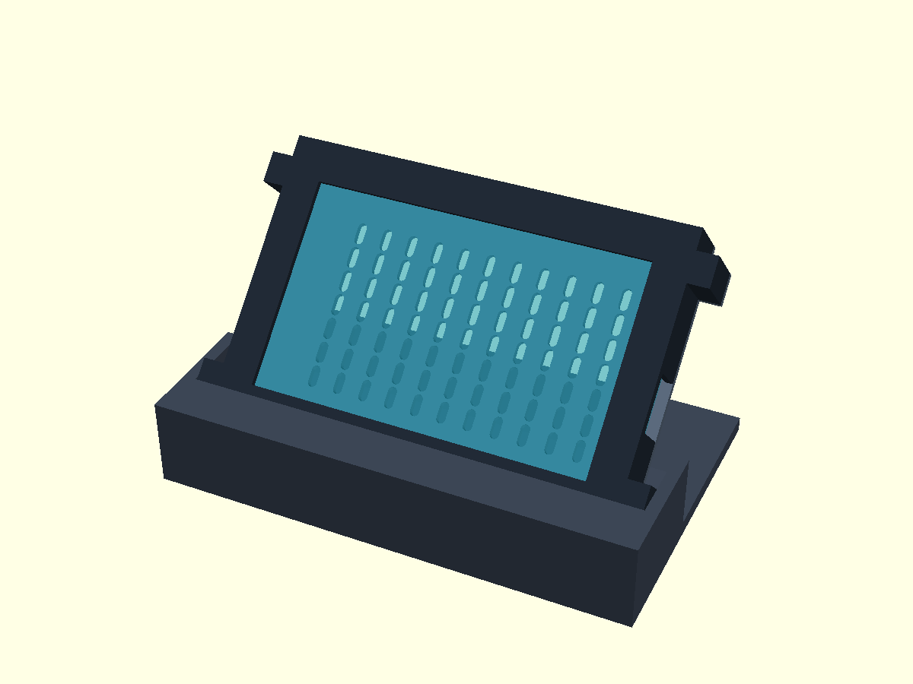

# Waveshare 5B enclosure and adjustable-angle cradle

Three printable parts make up the enclosure:

1. **Housing:** a front bezel with an open back. The display is inserted from
   the back, so it does not have to flex through the bezel opening.
2. **Rear cover:** closes the housing and attaches to four external screw ears.
   Vent holes can be disabled in the source. The screw holes do not go through
   the display glass or the board.
3. **Stand:** a separate, slotted cradle. Its `screen_angle` is fixed when the
   stand is printed and is measured from horizontal. The default is 45°.
   Change the parameter and re-export the stand for a different angle; this is
   not a movable hinge. The slot clears the cover ears during insertion.



## Important: prototype fit first

This is a **parametric first design, not a physically validated fit**. It uses
Waveshare's [touch-board dimensional drawing](https://www.waveshare.com/wiki/ESP32-S3-Touch-LCD-5)
for the 127.7 × 87.45 mm glass, 109 × 65.8 mm active area and approximately
14 mm overall thickness. Do not assume those dimensions cover every connector,
board revision or cable. In particular, `usb_center_y` and `usb_center_z` are
**provisional**. The default opening is on the right when looking at the screen
from the front. Verify the USB location and the actual plug housing dimensions
with the board in hand before printing the full housing. The opening extends to
the rear rim to let the board and protruding port be inserted.

Check glass size, PCB and terminal clearance, screw-ear pilot holes, and cable
insertion. The rear cavity allows about 18 mm behind the inner face of the
bezel; ensure the board and its components fit without contact with the cover.
If needed, adjust `case_depth`, USB parameters and clearances, and regenerate
**all** parts, including the stand. A `fit_test` coupon is available for a
housing corner and one screw ear; it does not test the USB port.

## Export

Open `agentlight.scad` in OpenSCAD and select `part` in the Customizer, or run:

```sh
openscad -o housing.stl -D 'part="housing"' agentlight.scad
openscad -o cover.stl -D 'part="cover"' -D 'vent_holes=true' agentlight.scad
openscad -o stand.stl -D 'part="stand"' -D 'screen_angle=45' agentlight.scad
openscad -o fit-test.stl -D 'part="fit_test"' agentlight.scad
```

Run these from the `enclosure` directory. The included STL files are generated
at the default settings, with vents and a 45° stand. The two special selections
`interference` and `screen_interference` are geometric checks: an empty result
means no overlap in the modeled assembly; it does **not** verify the real PCB,
USB plug or mechanical stability.

## Printing and assembly

- Print the housing with its flat **front down** (as exported), and the cover
  with its flat face down. Print the stand with its base on the bed. Start with
  a 0.2 mm layer height and at least three perimeters; review the slicer preview
  for overhangs and a solid stand base. The default stand is about 156 × 100 mm.
- Hardware: four M2.5 self-tapping screws, approximately 8 mm long, and thin
  non-conductive cushioning/foam. Test the 2.2 mm printed pilot hole with your
  screws and material. Screw tips must not protrude through the front of the
  housing; do not overtighten printed ears.
- With power and USB disconnected, place the screen **face down** on a clean,
  soft surface. Lower the housing over it, or lower the board into the housing
  from the rear, routing the USB socket into its side opening. The screen must
  lie flat without forcing the glass, ribbon cables or PCB.
- The housing does not use the PCB mounting holes. Use **small non-conductive
  foam pads** only on verified safe, flat structural areas at the rear to stop
  movement; size them after measuring the actual gap. Avoid components,
  exposed contacts, connectors and the Wi-Fi antenna. The cover must close
  freely without bending the PCB or pressing on the glass. If it does not,
  remove it and increase the depth or change the padding—never force it.
- Fit the rear cover and loosely start all four screws before tightening them
  gently. Verify the USB plug can enter and leave without rubbing or straining
  the socket, and confirm the active screen is unobstructed.
- Slide the closed case down into the stand, with the screen facing forward.
  Check that it seats on the bottom of the cradle, is stable when tapped, and
  that the cable does not tip it. Rubber feet or additional ballast may be
  needed; verify stability at your chosen angle before leaving it unattended.

The cover can be removed with the case out of the stand. Disconnect power
before opening it. The stand does not lock to the case: lift the case out to
move or service it. No test print or physical fit test has been performed yet.
