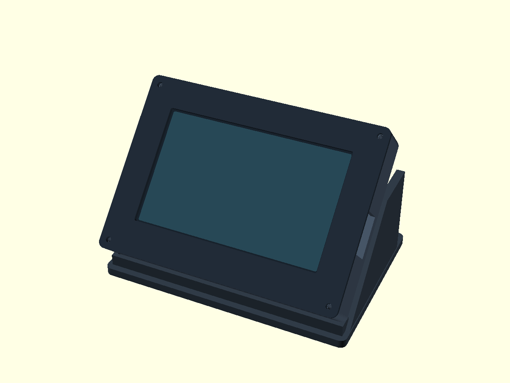
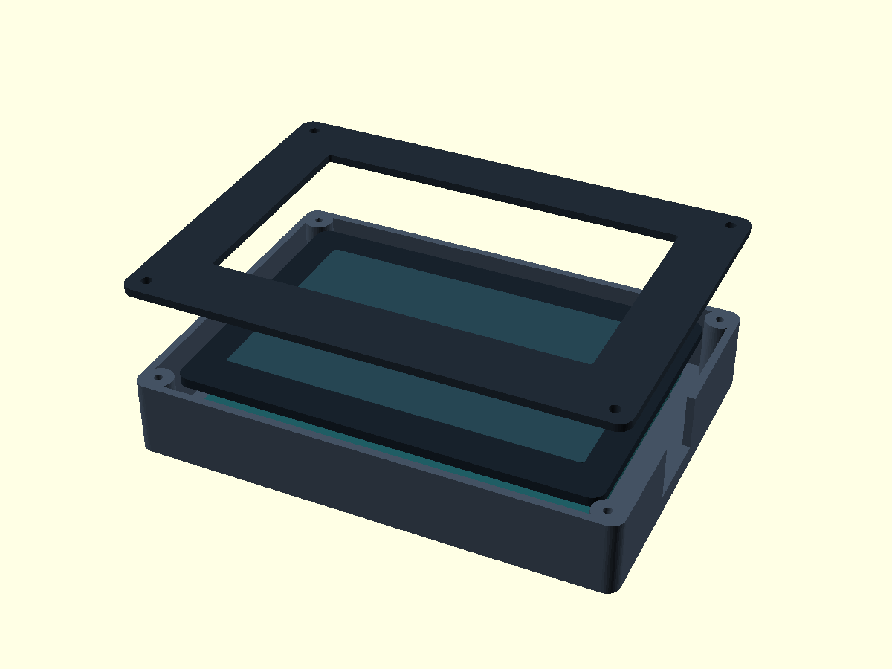

# Black-glass Waveshare 5B case — printable revision 2

> **Work in progress.** These designs are still changing and may not fit or print correctly.

Use these files, **not the first prototype in the parent directory**.

| Print file | Bed orientation (already exported this way) | Size |
|---|---|---|
| `shell.stl` | Flat rear outside on the bed; cavity and posts upward | 145 × 105 × 23 mm |
| `bezel.stl` | Flat bezel on the bed | 145 × 105 × 2.4 mm |
| `stand-45.stl` | Flat base on the bed | 151 × 105 × 60 mm |



## How the board is held

There are **two independent screw sets**:

1. **Board screws:** four M2.5 machine screws enter from the **outside rear**
   of the shell, pass through its floor and four hollow 6 mm posts, and engage
   the display's existing M2.5 rear mounts. The posts seat on the mounting
   faces, not on the PCB components. The hole pattern is 111 × 63 mm.
2. **Bezel screws:** four 3 mm plastic-thread-forming screws pass through the
   bezel into separate corner towers. These towers are outside the glass.
   They close the case; they do not fasten or squeeze the screen.

The board stays attached when the bezel is removed. There are no foam clamps,
external ears or screws through the glass. The stand supports the closed case;
lift the case out of the stand for servicing.



## Hardware and assembly

- 4 × **M2.5 × 10 mm machine screws**, preferably pan head, for the board.
  The modeled floor and post total 8.4 mm: these screws project **1.6 mm**
  into the display mounts. Check available thread depth; never bottom a screw
  against the display. Washers can shorten engagement if necessary.
- 4 × **3 × 8 mm plastic-thread-forming screws** for the bezel. The printed
  pilot is 2.5 mm. Test your chosen screw on scrap material first. No inserts
  or nuts are required. Do not substitute aggressive countersunk wood screws.
- Optional adhesive rubber feet for the stand.

1. Print and deburr the three parts, especially the post seating surfaces and
   USB opening. Do not enlarge the machine-screw holes in the display itself.
2. Disconnect USB and power. Place the shell rear-down, cavity-up. Lower the
   display into it, electronics facing the cavity and glass facing upward.
   Align all four rear mounts with the hollow posts. The USB socket is on the
   **right when looking at the screen** in this model.
3. Hold the board by its structural frame/mounting areas. Start the four M2.5
   screws from the shell's rear by hand; loosely start every screw before
   tightening gently. No force should be needed to align them. The rear
   components and terminal block must not touch the shell floor.
4. Lay the bezel over the glass without pressing on it. The model leaves a
   nominal **0.6 mm gap** above the glass. Secure its four corner screws.
   Stop if the bezel touches the glass or if the board bends.
5. Place the case in the stand. Plug the cable through the side opening and
   check clearance. The stand is a lift-out cradle, not a locking bracket.
   Add rubber feet and check stability under touch and cable loads.

## Print settings

Suggested starting point: PLA or PETG, 0.4 mm nozzle, 0.2 mm layers, 4 walls,
5 top/bottom layers, 20–25% infill. No raft. Use a brim only if necessary for
your material/bed adhesion.

The **default 45° exports are designed to print without supports**:

- The shell is an open-topped tray. Posts and screw towers grow vertically
  from the floor; the USB opening reaches the top, avoiding a bridge roof.
- The bezel is a flat ring, not an unsupported front overhang on the shell.
- The stand has two base-connected side cheeks and a front lip. The sloping
  case-contact faces are at 45°; there is no roof spanning the stand.
- Rear ventilation consists of vertical-through-floor holes.

Always inspect your slicer's layer preview. G-code is deliberately not supplied:
printer dimensions, temperatures, speeds and material profiles are machine-specific.

## Customizing

`case.scad` is the source. `angle=45` sets the screen angle **from horizontal**;
this is fixed when printed, not an adjustable hinge. `vents=false` gives a solid
rear panel. Export from this directory, for example:

```sh
openscad -o shell.stl -D 'part="shell"' case.scad
openscad -o bezel.stl -D 'part="bezel"' case.scad
openscad -o stand-45.stl -D 'part="stand"' -D 'angle=45' case.scad
```

Angles below 45° can create steeper overhangs on the stand: review supports in
your slicer rather than assuming all parameter combinations are support-free.

## Validation and dimensional limits

The source uses the **touch-version drawing**, not the metal-edged non-touch
version: 127.7 × 87.45 mm glass, 109 × 65.8 mm active area, 111 × 63 mm mounting
pattern and nominal 14 mm stack. The active opening has 1 mm extra on each side.
The rear mounts are offset 0.225 mm down from the glass center based on the
drawing outlines. The USB opening is deliberately generous (24 mm along the
side, open to the bezel) to accommodate the socket, adjacent buttons and plug.

**These are exported print files, not a physically fit-tested product.** In
particular the drawing's nominal 14 mm stack does not separately tolerance the
mount-to-glass distance; `mount_to_glass` is an exposed parameter. Stop assembly
if your board revision differs rather than forcing the screws or glass.

Validation performed:
- OpenSCAD exact-solid STL export for all parts.
- Single connected component, watertight and consistently oriented mesh for
  each part; flat minimum Z=0. Results are in `mesh-checks.json`.
- Empty intersection between the default stand and assembled case.
- Visual review of the assembled and exploded renders.

No slicer was available here, and no physical print or load test has been done.
The mesh checks establish valid solids, not printer-specific or physical-fit
certification.
